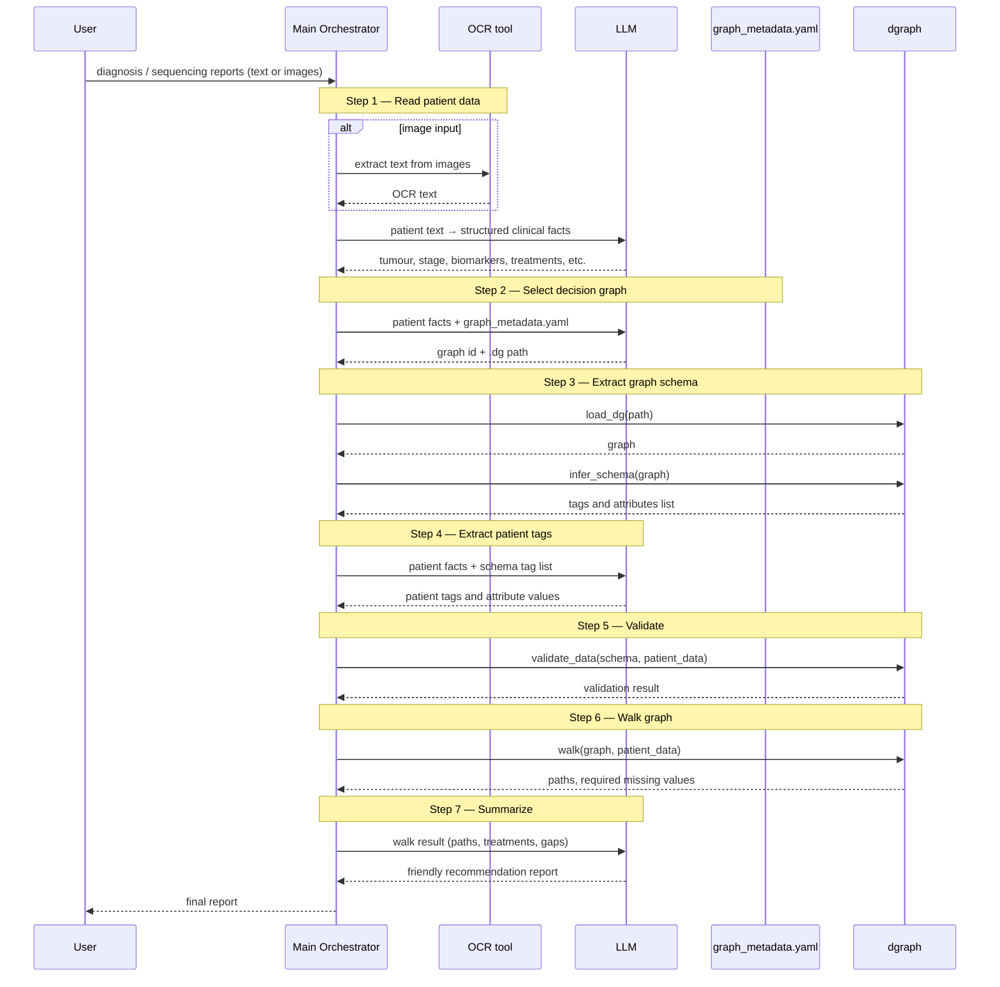
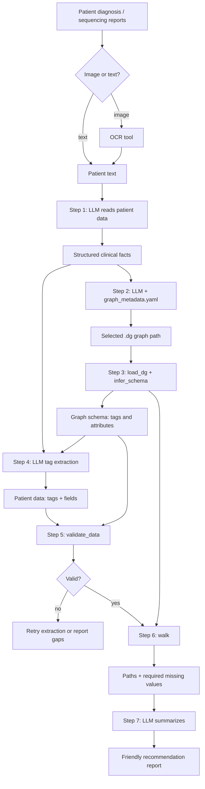

# Patient-to-Recommendation Architecture

## Design principle

Follow [llm_orchestration.jpeg](llm_orchestration.jpeg): separate **non-deterministic interpretation** from **deterministic clinical logic**.

| Responsibility                                              | Components                             |
| ----------------------------------------------------------- | -------------------------------------- |
| Read unstructured patient input (text or images)            | LLM + OCR /VLM                         |
| Route patient to correct decision graph                     | LLM (guided by`graph_metadata.yaml`) |
| Extract patient tags from free text                         | LLM (guided by graph schema)           |
| Summarize walk result in clinician-friendly language        | LLM                                    |
| Load graph, infer schema, validate patient data, walk graph | Deterministic dgraph (Python)          |

The curated `.dg` graph is the source of clinical logic. The LLM must not invent treatment paths — it only interprets input and communicates output.

---

## System components

### 1. Main Orchestrator

Central controller. Owns the pipeline state and delegates each step to the right component.

The orchestrator does not perform clinical reasoning itself. It passes structured context between steps and enforces gates (e.g. do not call `walk()` until validation passes or partial result is explicitly accepted).

### 2. LLM

Used at four points only:

1. **Patient data reading** — extract clinical facts from diagnosis/sequencing text (or OCR output): tumour type, stage, biomarkers, prior treatments, progression status, etc.
2. **Graph routing** — compare extracted patient conditions against `graph_metadata.yaml` and return which `.dg` graph to load.
3. **Tag extraction** — map patient facts to the exact tags and attributes the selected graph expects (schema-driven).
4. **Summarization** — turn the deterministic `walk()` result into a readable recommendation report.

Each call returns structured JSON. The orchestrator validates outputs before proceeding.

### 3. OCR tools

For image-based patient reports (scanned pathology, sequencing PDFs, screenshots). Produces plain text fed into step 1. No clinical reasoning — text extraction only.

### 4. Deterministic dgraph

Existing Python library. Used for all graph operations:

| Operation                               | Purpose                                                                                 |
| --------------------------------------- | --------------------------------------------------------------------------------------- |
| `load_dg(path)`                       | Load the selected curated decision graph                                                |
| `infer_schema(graph)`                 | Extract the tags and attributes the graph expects                                       |
| `validate_data(schema, patient_data)` | Check extracted patient data against schema before walking                              |
| `walk(graph, patient_data)`           | Traverse the graph deterministically; return matching paths and required missing values |

Router graphs (e.g. [mnsclc_mol_pos.dg](../data/mnsclc/dg/mnsclc_mol_pos.dg)) handle sub-graph selection internally via tags — the orchestrator only needs to load the correct entry graph.

### 5. graph_metadata.yaml

Single routing catalog. Maps **tumour types and clinical conditions** to the abbreviations and `.dg` graphs used in this project.

Can be seeded from [esmo_guidelines_directory.xlsx](../data/esmo_guidelines_directory.xlsx) (63 ESMO tumour subtypes with abbreviations like `mnsclc`, `ebc`, `nomnsclc`) and extended with graph-level entries as `.dg` files are onboarded.

Example shape:

```yaml
graphs:
  - id: mnsclc_mol_pos
    disease: mnsclc
    name: Oncogene-Addicted Metastatic NSCLC
    category: Lung Cancer
    conditions:
      - stage IV NSCLC
      - molecular alteration positive
      - EGFR / ALK / ROS1 / BRAF / RET / NTRK / HER2 / MET / KRAS
    dg_path: data/mnsclc/dg/mnsclc_mol_pos.dg
    role: router

  - id: ebc_treatment
    abbrev: ebc
    name: Early Breast Cancer
    category: Breast Cancer
    conditions:
      - early breast cancer
      - adjuvant or neoadjuvant setting
    graph: data/ebc/dg/ebc.dg
    role: entry
```

Grows alongside graph onboarding. New tumour graphs = new `graph_metadata.yaml` entry; no orchestrator logic changes.

---

## Orchestrator pipeline



---

## End-to-end data flow



---

## Success criteria

1. Given a patient sequencing report, the orchestrator selects the correct graph from `graph_metadata.yaml`.
2. Extracted patient tags pass `validate_data()` against the graph schema.
3. `walk()` returns paths consistent with hand-verified fixture patients.
4. The final report cites only graph-derived treatments and clearly states missing information.
5. Onboarding a new tumour graph requires only a curated `.dg` file and a `graph_metadata.yaml` entry.
